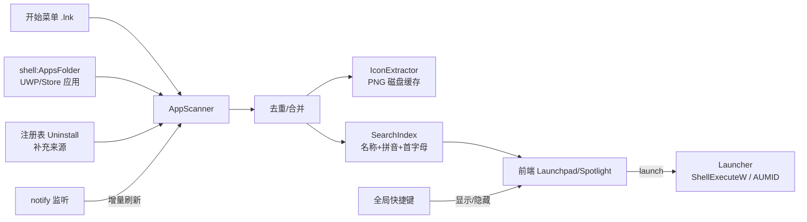

# Windows 工作台技术方案（Rust + Tauri）

仿照 macOS Launchpad / Spotlight，为 Windows 开发的应用工作台。

## 0. 功能需求

- 查找 Windows 中安装的所有应用（Win32 + UWP/商店应用）
- 搜索应用（模糊匹配、拼音/首字母）
- 全局快捷键唤起工作台
- 开机启动
- 两种 UI 形态：**Launchpad 全屏网格** 与 **Spotlight 居中搜索条**，可在设置中切换

## 1. 技术选型

| 层 | 选型 | 说明 |
|---|---|---|
| 框架 | **Tauri 2.x** | 体积小（~5MB），内存低，使用 WebView2 |
| 前端 | **Vite + React + TypeScript** | Launchpad 网格 / Spotlight 搜索 UI |
| 系统 API | `windows` crate（官方） | Shell、COM、图标等 Win32 接口 |
| 全局快捷键 | `tauri-plugin-global-shortcut` | 默认 `Alt+Space`，可自定义 |
| 开机启动 | `tauri-plugin-autostart` | 写入 `HKCU\Software\Microsoft\Windows\CurrentVersion\Run` |
| 单实例 | `tauri-plugin-single-instance` | 防止多开 |
| 毛玻璃效果 | `window-vibrancy` | Win11 Mica / Win10 Acrylic |
| 模糊搜索 | `nucleo-matcher`（或 `fuzzy-matcher`） | 高性能模糊匹配 |
| 拼音搜索 | `pinyin` crate | 全拼 + 首字母，如 `wx` → 微信 |
| 目录监听 | `notify` | 开始菜单变化时增量刷新 |
| 存储 | `rusqlite` / `tauri-plugin-store` | 配置、使用频率、图标缓存索引 |

## 2. 架构



## 3. 核心模块设计

### 3.1 应用扫描（AppScanner）—— 核心难点

- **主方案：枚举 `shell:AppsFolder`**
  - `SHGetKnownFolderItem(FOLDERID_AppsFolder)` + `IShellItem` 遍历
  - 结果与开始菜单「所有应用」一致，同时包含 Win32 与 UWP 应用
  - 每项可获得 `AppUserModelID`（AUMID），启动方式统一
- **补充：扫描开始菜单 `.lnk`**
  - `%ProgramData%\Microsoft\Windows\Start Menu\Programs\**\*.lnk`
  - `%AppData%\Microsoft\Windows\Start Menu\Programs\**\*.lnk`
  - 通过 `IShellLinkW`（或 `lnk` crate）解析目标路径
  - 过滤「卸载 / Uninstall / 帮助 / Readme」等非应用条目
- **去重**：以目标 exe 路径 / AUMID 为唯一键
- **性能**：后台线程扫描；启动时先读缓存秒开，再异步刷新

### 3.2 图标提取（IconExtractor）

- 优先 `IShellItemImageFactory::GetImage` 获取 256px 图标，回退 `SHGetFileInfoW`
- HBITMAP → PNG（`image` crate），缓存至 `%LocalAppData%\<app>\icons\<hash>.png`
- 前端通过自定义协议 `icon://` 或 `convertFileSrc` 加载，避免 base64 占用内存

### 3.3 搜索（SearchIndex）

- 索引字段：显示名、拼音全拼、拼音首字母、exe 文件名
- 排序：`模糊匹配分 × 权重 + 使用频率/最近使用加成`
- 搜索在 Rust 端完成，数千应用 < 1ms

### 3.4 启动（Launcher）

- Win32：`ShellExecuteW`；支持「以管理员运行」（`runas`）
- UWP：`IApplicationActivationManager::ActivateApplication(AUMID)`，或 `explorer shell:AppsFolder\<AUMID>`
- 支持「打开文件所在位置」
- 启动后记录使用次数与时间

### 3.5 窗口与交互

- 无边框、透明、置顶、不显示在任务栏（`skipTaskbar`）、失焦自动隐藏
- **常驻后台**：快捷键仅切换窗口显示/隐藏，保证唤起速度
- 系统托盘：设置、重建索引、开机启动开关、退出
- 键盘：方向键选择、`Enter` 启动、`Esc` 隐藏、`Ctrl+数字` 快速启动

### 3.6 双 UI 模式

| 模式 | 形态 | 窗口 |
|---|---|---|
| Launchpad | 全屏毛玻璃背景 + 分页应用网格 + 顶部搜索 | 全屏覆盖当前显示器 |
| Spotlight | 居中搜索条（约 680px 宽）+ 结果列表 | 居中小窗，高度随结果变化 |

- 共用同一窗口与同一套搜索 / 启动 / 键盘逻辑，仅布局不同
- 切换模式时由 Rust 端调整窗口尺寸与位置，前端切换布局组件
- 设置项：默认模式；可为两种模式分别配置快捷键（如 `Alt+Space` → Spotlight，`Alt+L` → Launchpad）

### 3.7 快捷键与开机启动

- 快捷键在设置中可改；注册失败（被占用）时提示用户
- `Win+X` 类组合为系统保留，无法注册
- 开机启动时附带 `--hidden` 参数，静默驻留托盘

## 4. 项目结构

```
work_bench/
├─ src/                          # 前端 React + TS
│  ├─ components/
│  │  ├─ SearchBar.tsx
│  │  ├─ LaunchpadView.tsx       # 全屏网格
│  │  ├─ SpotlightView.tsx       # 搜索条 + 列表
│  │  └─ Settings.tsx
│  ├─ hooks/                     # 搜索、键盘导航
│  └─ api.ts                     # invoke 封装
└─ src-tauri/src/
   ├─ main.rs / lib.rs           # 插件、托盘、窗口初始化
   ├─ scanner/
   │  ├─ apps_folder.rs          # shell:AppsFolder 枚举
   │  ├─ start_menu.rs           # .lnk 扫描
   │  └─ dedup.rs
   ├─ icon.rs
   ├─ search.rs                  # nucleo + 拼音
   ├─ launcher.rs
   ├─ window.rs                  # 模式切换、显示/隐藏、vibrancy
   ├─ storage.rs                 # 配置 / 使用频率
   ├─ watcher.rs
   └─ commands.rs                # list_apps / search / launch / get_settings / set_settings
```

## 5. 里程碑

1. **M1**：Tauri 骨架、托盘、全局快捷键唤起/隐藏、单实例
2. **M2**：应用扫描 + 图标缓存 + 网格展示
3. **M3**：模糊/拼音搜索、键盘操作、启动应用
4. **M4**：开机启动、设置页、双模式切换、使用频率排序、目录监听
5. **M5**：毛玻璃视觉、动画、NSIS 安装包（内嵌 WebView2 引导）

## 6. 风险与注意事项

- `Alt+Space` 与系统窗口菜单 / PowerToys Run 冲突 → 快捷键需可配置
- 部分旧版 Win10 未预装 WebView2 → 安装包内置引导程序
- 普通权限进程无法向管理员窗口抢焦点（系统限制）
- 首次图标提取较慢 → 后台线程 + 磁盘缓存
- 多显示器：Launchpad 在鼠标所在显示器全屏显示
